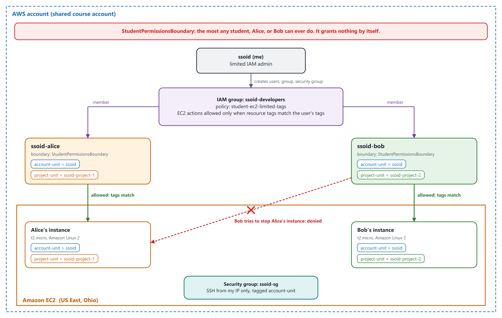
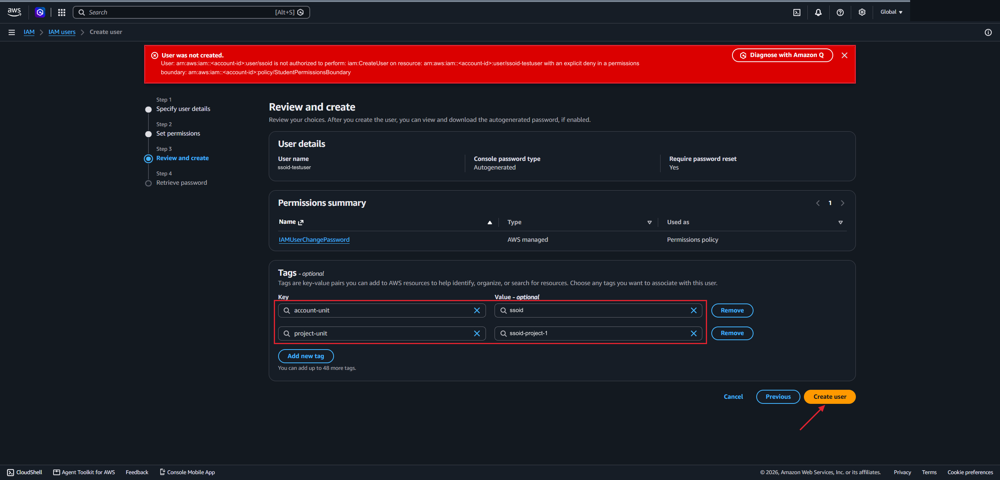
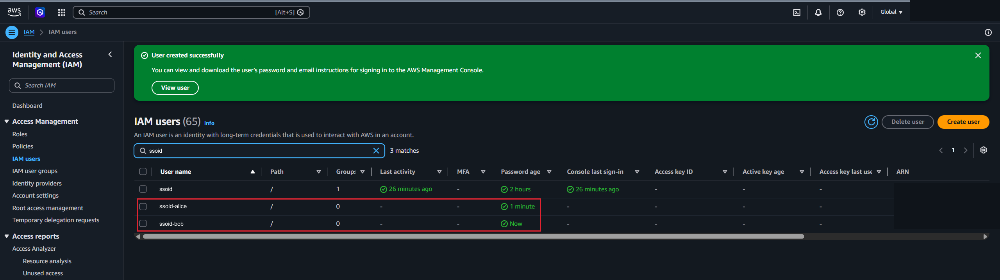
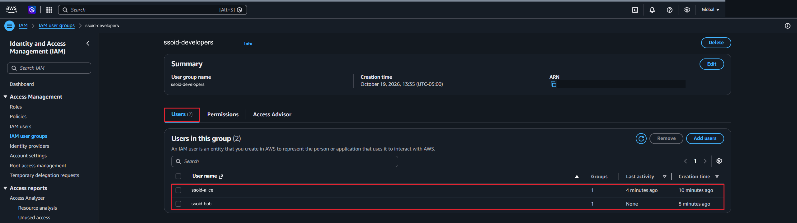
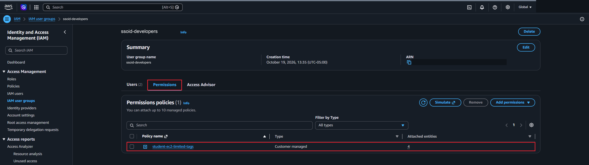
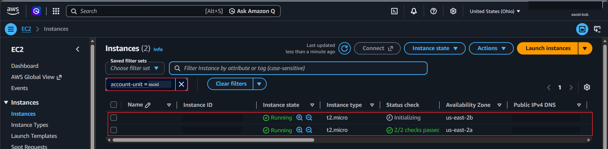
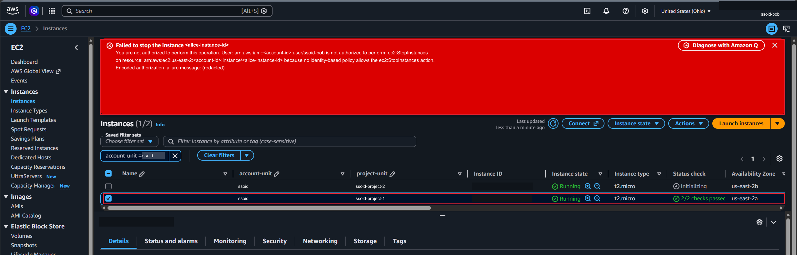

# Lab 6 — Access Control with IAM: Permissions Boundaries, Groups, and Tags

## Overview

This lab was about **access control** in AWS using **IAM (Identity and Access Management)**. It was done in a real, shared AWS account where every student was set up as a limited IAM administrator. I created two users, Alice and Bob, put them in a group with a policy that only lets them work with EC2, and then signed in as each of them to test it.

The interesting part was how three things stack together:

- A **permissions boundary** sets the most a user could ever do.
- A **policy** on a group actually grants permissions.
- **Tags** decide which resources each user is allowed to touch. This is attribute-based access control (ABAC).

In the end, Alice and Bob could each launch and manage their own EC2 instance, but when Bob tried to stop Alice's instance, AWS denied it.

> Throughout this write-up, `ssoid` stands in for my university ID. Every name and tag in the lab used it as a prefix, like `ssoid-alice`.

## Objectives

- Confirm that a user can't be created without the required permissions boundary
- Create two users with a permissions boundary and tags
- Show that new users have no permissions by default
- Grant permissions through a group and a managed policy
- Launch an EC2 instance as each user with the required tags
- Test that one user can't act on another user's instance

## Tools & Technologies

| Category | Tools |
|---|---|
| Cloud platform | Amazon Web Services (AWS) |
| Services | IAM, Amazon EC2 |
| Objects | IAM users, IAM group, permissions boundary, customer managed policy, tags, security group, key pairs, EC2 instances |
| Region | US East (Ohio) `us-east-2` |

## Lab Setup

This is the architecture.

| | ssoid-alice | ssoid-bob |
|---|---|---|
| Permissions boundary | `StudentPermissionsBoundary` | `StudentPermissionsBoundary` |
| Group | `ssoid-developers` | `ssoid-developers` |
| Tag `account-unit` | `ssoid` | `ssoid` |
| Tag `project-unit` | `ssoid-project-1` | `ssoid-project-2` |

---

## Task 1 — Create Users with a Permissions Boundary and Tags

### 1.1 What a permissions boundary does

A **permissions boundary** is a policy attached to a user or role that sets the **maximum** permissions it can ever have. It doesn't grant anything by itself. It only limits what other policies are allowed to grant.

In this account, my own student user had `StudentPermissionsBoundary` on it, and that boundary also required every user I created to have the same boundary. That way I couldn't create a user with more power than I have, which is how the account prevents **privilege escalation**.

### 1.2 Try to create a user without the boundary

I tried creating `ssoid-testuser` with console access and the two tags, but **no** permissions boundary. It failed:

> User was not created. ... is not authorized to perform: iam:CreateUser ... with an explicit deny in a permissions boundary

### 1.3 Create Alice and Bob

I created two users with console access and a password they must change at first sign-in. On the permissions step I chose **Use a permissions boundary to control the maximum user permissions** and picked `StudentPermissionsBoundary`. I didn't add them to a group yet.

Each user got two tags:

- `account-unit = ssoid` ties the user to me, so other students can't touch it.
- `project-unit` separates Alice (`ssoid-project-1`) from Bob (`ssoid-project-2`).

---

## Task 2 — Default Permissions and Granting Access with a Group

### 2.1 No permissions by default

In a private browser window I signed in as `ssoid-alice` and changed her password. She could sign in, but she couldn't use EC2 or anything else. IAM starts every user with an **implicit deny**. Having an identity and passing authentication is not the same as being authorized.

### 2.2 Create the group and attach the policy

Back as myself, I created the group `ssoid-developers` and added both users to it.

Then I attached the customer managed policy `student-ec2-limited-tags`. It lets users launch and manage EC2 instances, but only instances whose tags match their own `account-unit` and `project-unit` tags.

Putting the policy on the group instead of each user makes it easier to manage. Anyone added to the group gets the same access, and anyone removed loses it.

---

## Task 3 — Test the Policy as Alice and Bob

### 3.1 Setup as me

All of this happened in **US East (Ohio)**. As myself, I created a security group named `ssoid-sg` that only allows **SSH from my own IP address**, and tagged it `account-unit = ssoid`. Only admins could create security groups in this setup, so Alice and Bob would use mine.

### 3.2 Launch an instance as Alice

In a private window as `ssoid-alice`, I:

1. Created a key pair, `ssoid-alice-key-pair` (`.pem`), tagged with her two tags.
2. Launched an instance with these settings:

| Setting | Value |
|---|---|
| AMI | Amazon Linux 2 (64-bit x86) |
| Instance type | `t2.micro` |
| Tags (instance **and** volume) | `account-unit = ssoid`, `project-unit = ssoid-project-1` |
| Name tag | Removed |
| Security group | `ssoid-sg` |
| Key pair | `ssoid-alice-key-pair` |

The policy only allows a launch when the new instance has **exactly** the same tags and values as the user, so the launch wouldn't go through without them.

### 3.3 Launch an instance as Bob

I repeated the same steps as `ssoid-bob`, with `ssoid-bob-key-pair` and `project-unit = ssoid-project-2`. Filtering the instance list by `account-unit = ssoid` showed both instances running.

### 3.4 Bob tries to stop Alice's instance

Still signed in as Bob, I added the `account-unit` and `project-unit` tags as columns, selected the instance tagged `ssoid-project-1` (Alice's), and chose **Instance state → Stop instance**. AWS denied it:

> You are not authorized to perform this operation. User: ...ssoid-bob is not authorized to perform: ec2:StopInstances on resource: ...

Bob is in the same group with the same policy as Alice, but his `project-unit` tag doesn't match her instance's tag, so the policy doesn't allow the action.

---

## Cleaning Up and Why Cost Matters

After getting my screenshots I terminated both instances and deleted the security group, both key pairs, both users, and the group, in that order so nothing was blocked by something that depended on it.

Cleaning up mattered more than usual in this lab because it ran in a real account that someone else pays for. In the cloud you pay for what you use, and an instance keeps billing for as long as it's running, even if nobody is using it. Thinking about it from a business point of view:

- **Forgotten resources add up.** One small instance is cheap, but a team with dozens of them left running after a project ends can add a real amount to the monthly bill.
- **Unused resources are a security risk too.** Old instances, keys, and users that nobody remembers are easy targets, especially after the people who used them leave or move to other teams.
- **Users are resources too.** When someone changes jobs or leaves, their access has to change with them.

This is a big part of why permissions matter. Limiting who can launch resources, what they can launch, and what they can change keeps spending under control as well as keeping data safe. In this lab, the boundary and the tag-based policy meant Alice and Bob could only create small EC2 instances in their own project. They couldn't start other services, and they couldn't change anyone else's resources. Tags also make it easy to see who owns what, so a company can find out what is costing money and clean it up.

---

## What I Learned

- **Identification, authentication, and authorization** are separate steps. Alice could sign in, but she couldn't do anything until a policy allowed it.
- New IAM users start with an implicit deny for everything
- A permissions boundary only sets a ceiling. It doesn't grant anything, and it stops admins from creating users more powerful than themselves.
- Attaching a policy to a group is easier to manage than attaching it to each user
- Policies can include **conditions**, like requiring tags on a new resource to match the user's tags
- Tags work as attributes for **ABAC**, so one policy can keep Alice, Bob, and every other student's users separated
- Testing as each user in a private window is a good way to check that a policy works the way I expect
- Cleaning up after a lab saves money and removes things an attacker could use, and good permissions help with both

---

> **Note:** Screenshots are from a shared course AWS account. The account ID, my university ID (replaced with `ssoid`), ARNs, instance IDs, public DNS names, and the encoded authorization message have been redacted. All resources I created were deleted after the lab.

[← Back to AWS Labs](../)
