# Lab 7 — Working with Amazon EBS: Volumes and Snapshots

## Overview

This lab was about **Amazon EBS (Elastic Block Store)**, the network-attached storage that EC2 instances use as disks. I created a new 1 GiB volume, attached it to an instance, and set it up from the Linux command line with a file system and a mount point. Then I wrote a file to it, took a **snapshot**, deleted the file, and restored the snapshot to a brand new volume.

When I mounted the restored volume, the file I deleted was back. That was the whole point of the lab: a snapshot is a backup I can rebuild a disk from.

## Objectives

- Create an EBS volume
- Attach and mount the volume to an EC2 instance
- Create a snapshot of the volume
- Create a new volume from the snapshot
- Attach and mount the new volume and check that the data came back

## Tools & Technologies

| Category | Tools |
|---|---|
| Cloud platform | Amazon Web Services (AWS) |
| Services | Amazon EC2, Amazon EBS, AWS Systems Manager Session Manager |
| Objects | EBS volumes, EBS snapshot, EC2 instance |
| Linux tools | `df`, `mkfs`, `mkdir`, `mount`, `/etc/fstab` |
| Region | US East (N. Virginia) `us-east-1` |

## What EBS Is

| Feature | What it means |
|---|---|
| Persistent | A volume keeps its data even if the instance it's attached to stops or goes away |
| Block storage | A volume is a raw disk, so I have to put a file system on it myself |
| Tied to one Availability Zone | A volume can only attach to an instance in the same AZ |
| Replicated | AWS copies the volume within its AZ for reliability |
| Snapshots | Point-in-time backups stored in Amazon S3, which can be turned back into new volumes |

## Architecture

This is the architecture.

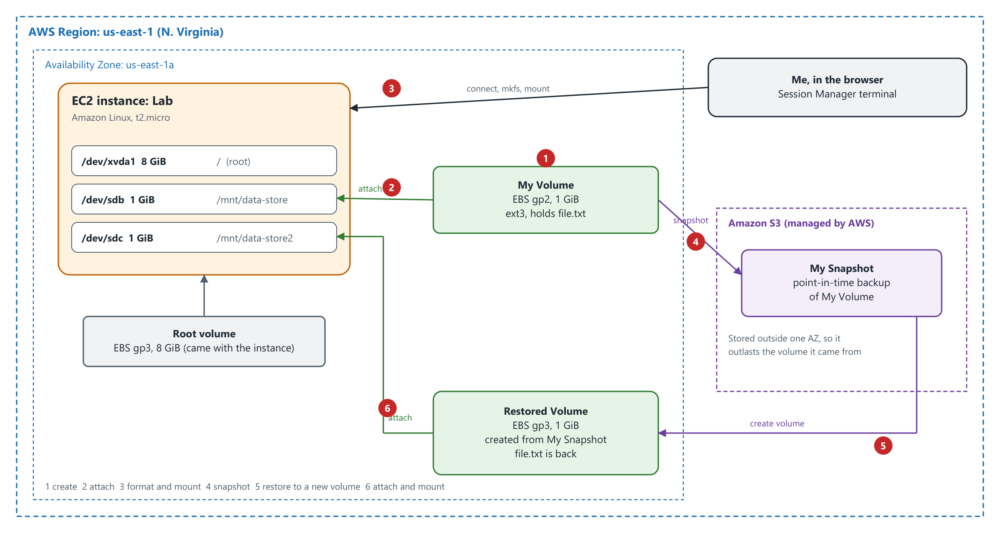

---

## Task 1 — Create a New EBS Volume

### 1.1 Check the instance's Availability Zone

**EC2 → Instances.** An instance named **Lab** was already running. I noted its Availability Zone, `us-east-1a`, because a new volume has to be in the same AZ to attach to it.

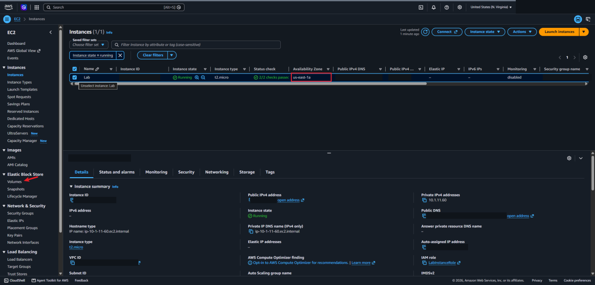

### 1.2 Create the volume

**Elastic Block Store → Volumes → Create volume.** The only volume there was the instance's 8 GiB root volume.

| Setting | Value |
|---|---|
| Volume type | General Purpose SSD (gp2) |
| Size | 1 GiB |
| Availability Zone | `us-east-1a` (same as the instance) |
| Tag | `Name = My Volume` |

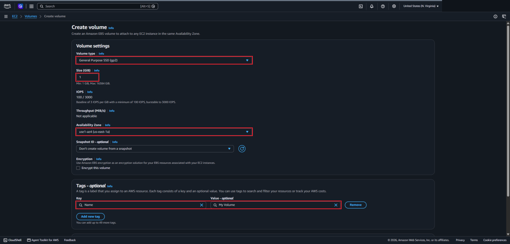

**My Volume** showed up in the list as **Creating** and then became **Available**.

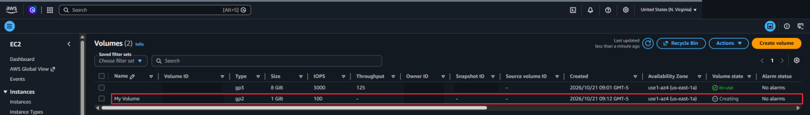

---

## Task 2 — Attach the Volume to the Instance

I selected My Volume and chose **Actions → Attach volume**, picked the **Lab** instance, and set the device name to `/dev/sdb`. Only instances in the same AZ show up in the list.

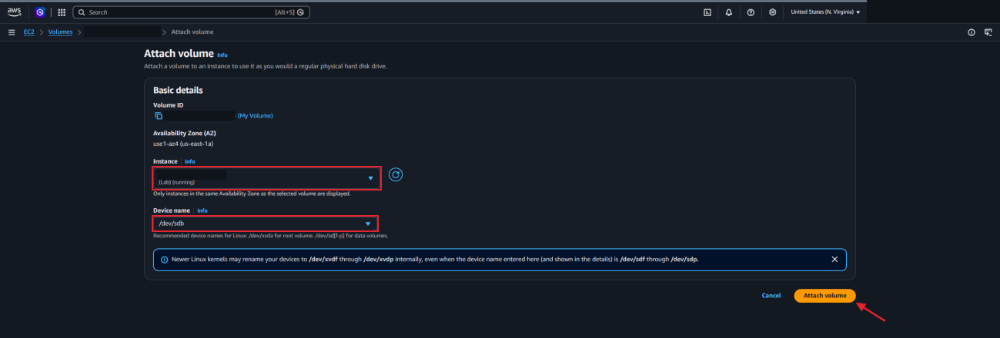

The volume state changed to **In-use**.

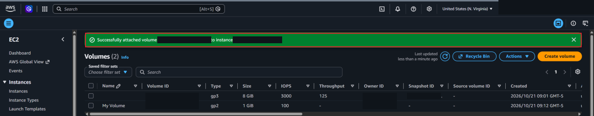

---

## Task 3 — Connect to the Instance

**Instances → Lab → Connect → Session Manager → Connect.** This opened a terminal in the browser without SSH keys or an open inbound port. Then I switched to the `ec2-user` account:

```bash
sudo su -l ec2-user
```

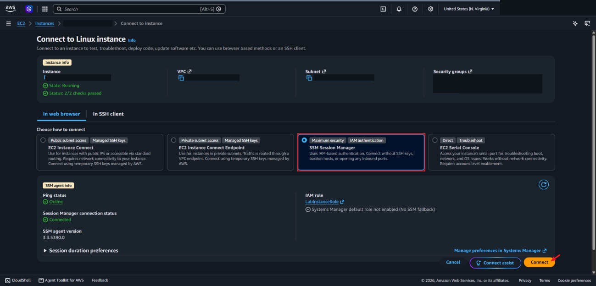

---

## Task 4 — Create and Mount a File System

A new EBS volume is a blank disk, so it needs a file system and a place to mount it before Linux can use it.

```bash
df -h                                   # only the 8 GiB root disk is listed
sudo mkfs -t ext3 /dev/sdb              # put an ext3 file system on the new volume
sudo mkdir /mnt/data-store              # make a mount point
sudo mount /dev/sdb /mnt/data-store     # mount the volume there
echo "/dev/sdb   /mnt/data-store ext3 defaults,noatime 1 2" | sudo tee -a /etc/fstab
cat /etc/fstab                          # check the new line at the bottom
df -h                                   # the new volume now shows up
sudo sh -c "echo some text has been written > /mnt/data-store/file.txt"
cat /mnt/data-store/file.txt
```

The line added to `/etc/fstab` makes Linux mount the volume again every time the instance boots. Without it, the mount would be gone after a restart.

After mounting, `df -h` listed the new volume as `/dev/xvdb` (about 975M) on `/mnt/data-store`. I attached it as `/dev/sdb`, but newer Linux kernels can rename devices, which the attach page warns about. Then I wrote `file.txt` and read it back.

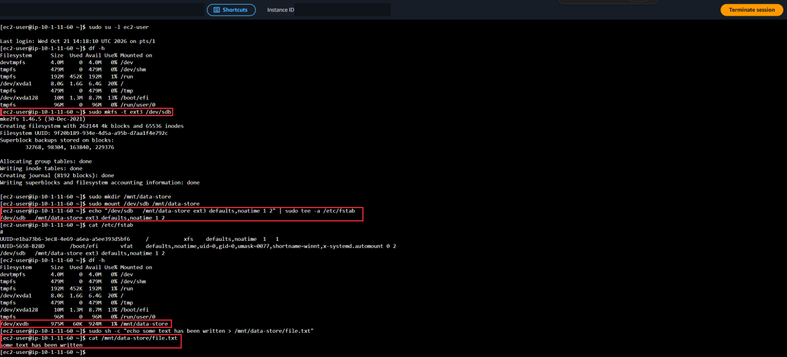

---

## Task 5 — Create a Snapshot

### 5.1 Take the snapshot

**Volumes → My Volume → Actions → Create snapshot**, tagged `Name = My Snapshot`.

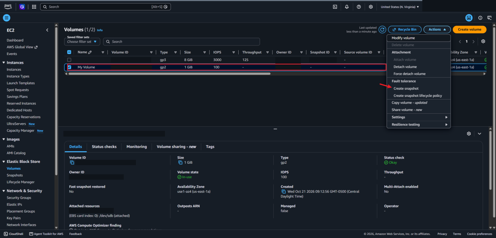

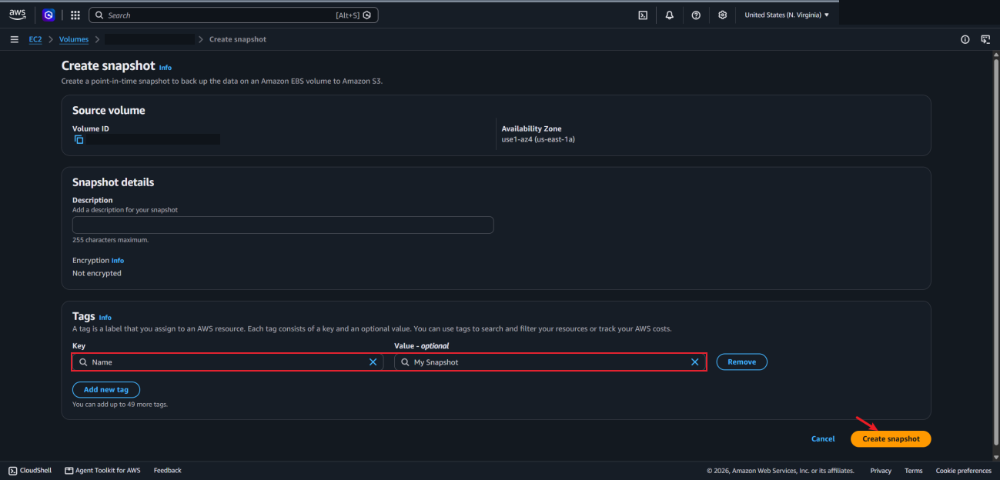

Under **Snapshots** it started as **Pending** and then changed to **Completed**. Only blocks that hold data get copied, so the finished snapshot was 53 MiB even though the volume is 1 GiB.

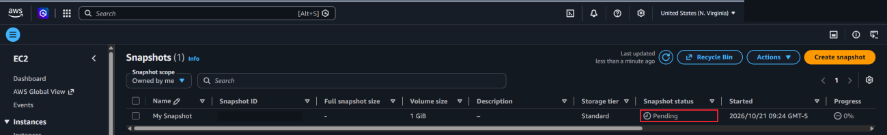

### 5.2 Delete the file

Back in the terminal I deleted the file to simulate losing data:

```bash
sudo rm /mnt/data-store/file.txt
ls /mnt/data-store/
```

Only `lost+found` was left, which is a folder ext3 creates on its own.

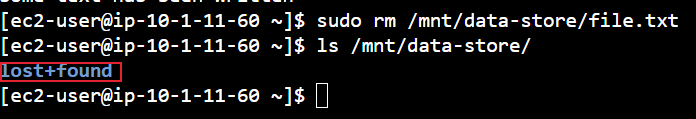

---

## Task 6 — Restore the Snapshot

### 6.1 Create a volume from the snapshot

**Snapshots → My Snapshot → Actions → Create volume from snapshot.**

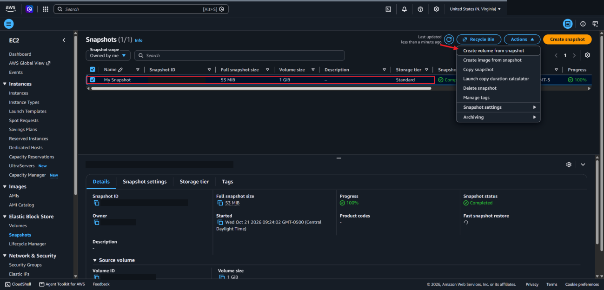

I kept it in `us-east-1a` and tagged it `Name = Restored Volume`. This page defaulted to gp3, so the restored volume is a different type from the original gp2 one. Restoring is a chance to change the type, size, or AZ.

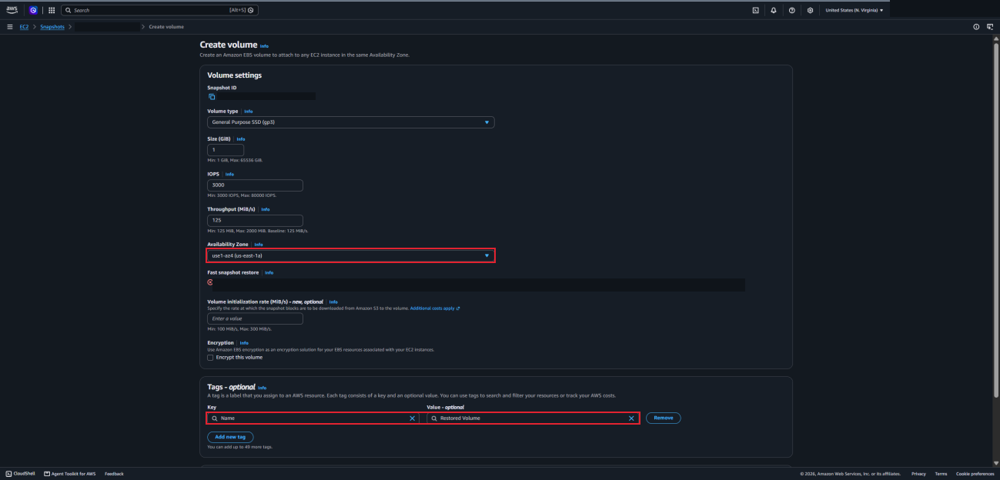

### 6.2 Attach it

**Volumes → Restored Volume → Actions → Attach volume**, to the Lab instance as `/dev/sdc`.

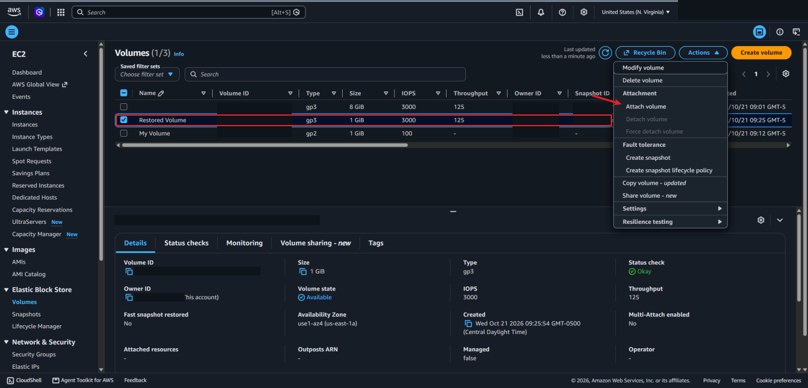

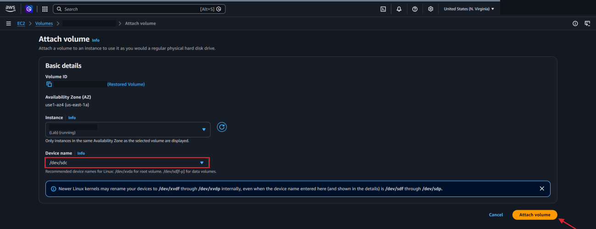

### 6.3 Mount it and check the file

```bash
sudo mkdir /mnt/data-store2
sudo mount /dev/sdc /mnt/data-store2
ls /mnt/data-store2/
```

`file.txt` was there. I didn't run `mkfs` this time, because the snapshot already had the ext3 file system and the data on it.

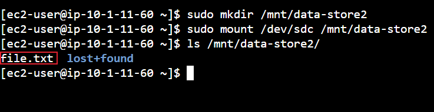

---

## What I Learned

- An EBS volume is a network disk that keeps its data separately from the instance
- A volume has to be in the same Availability Zone as the instance it attaches to
- A new volume is blank. It needs a file system (`mkfs`) and a mount point (`mount`) before Linux can use it.
- Adding the volume to `/etc/fstab` keeps it mounted after a reboot
- The device name I pick in the console isn't always the name Linux uses (`/dev/sdb` showed up as `/dev/xvdb`)
- A snapshot is a point-in-time backup stored in S3, and it only stores the blocks that have data
- Restoring a snapshot makes a new volume with the file system and files already on it, and I can change settings like the volume type while restoring

---

> **Note:** Screenshots are from a temporary AWS lab account. The AWS account ID, my lab session username and session ID, the public IP addresses and DNS names, and the IDs of the instance, volumes, snapshot, VPC, subnet, and security group have been redacted. The environment was shut down after I finished.

[← Back to AWS Labs](../)
