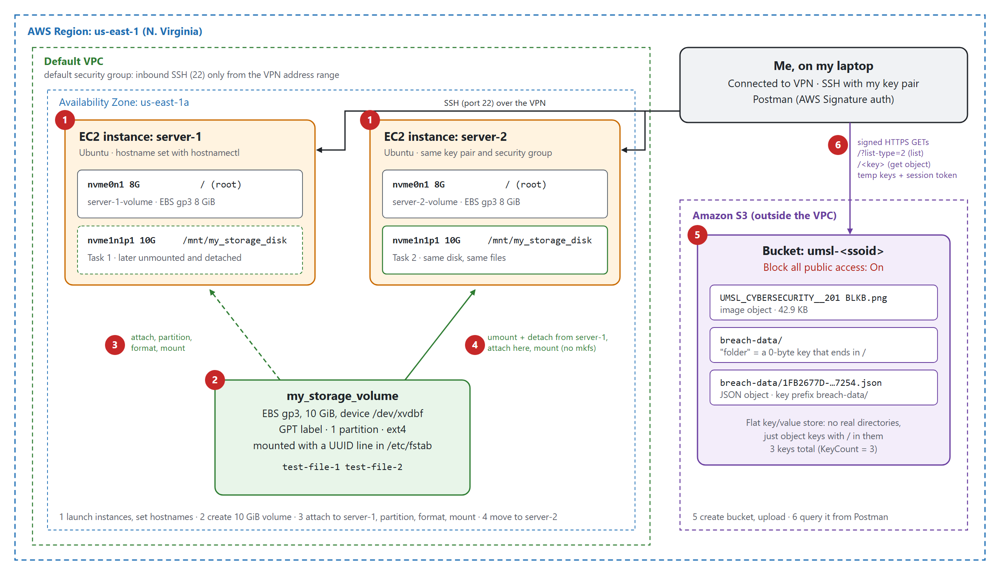
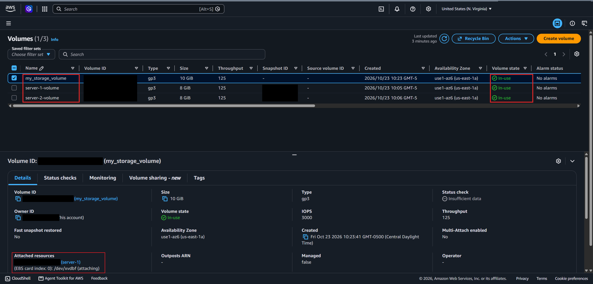
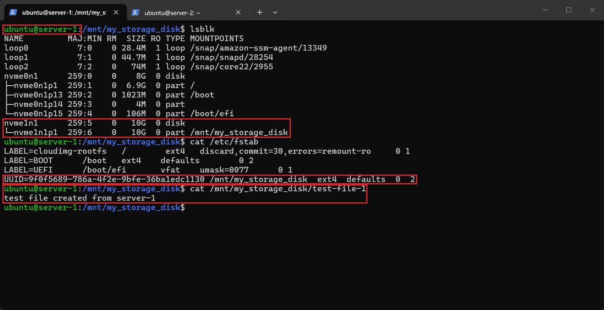
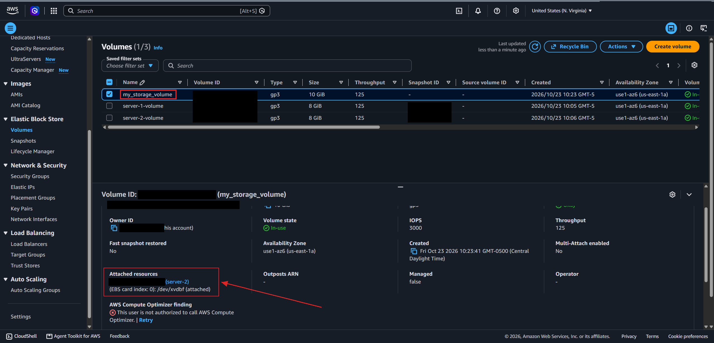
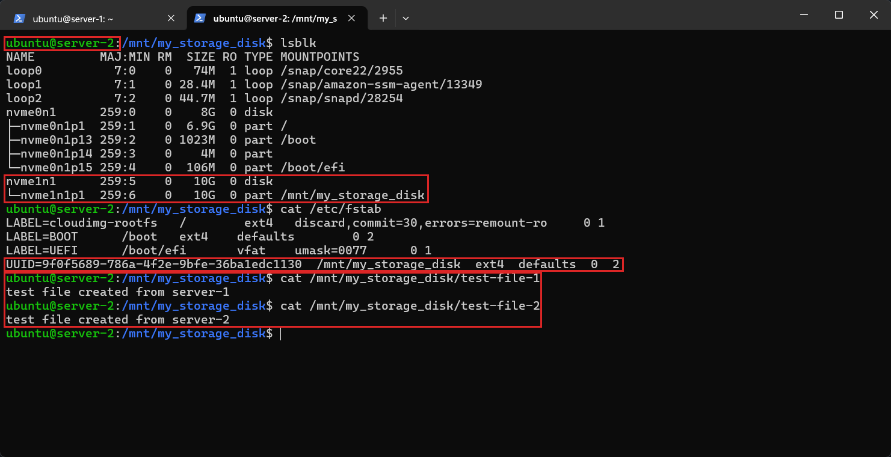
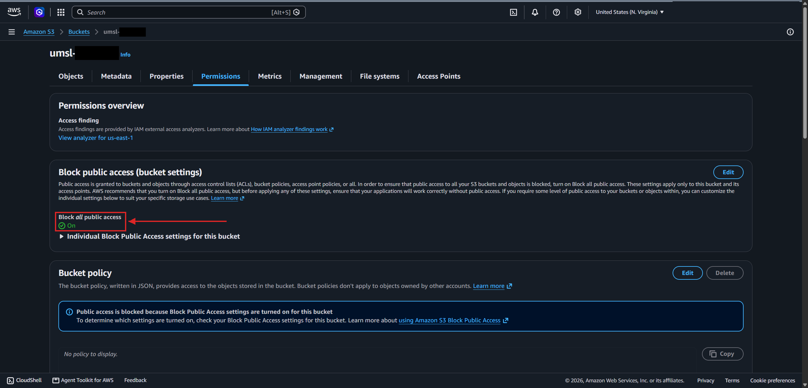
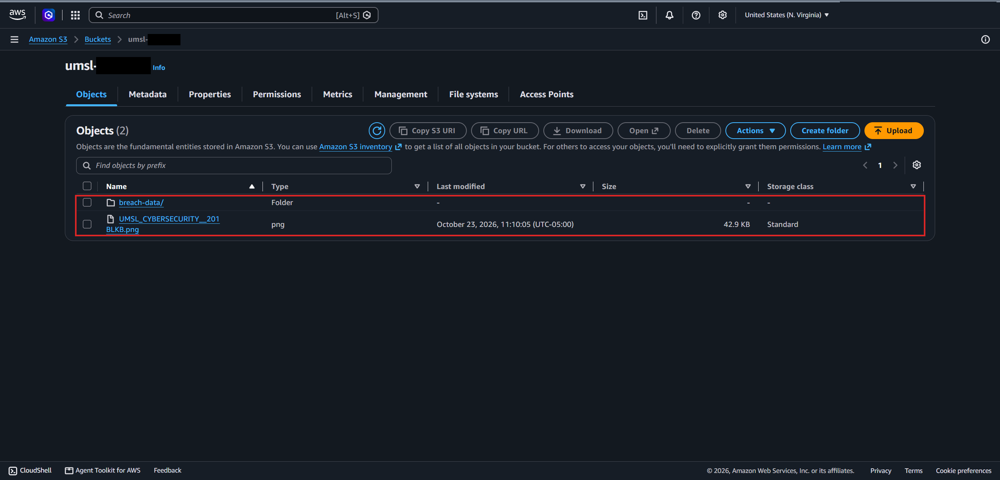
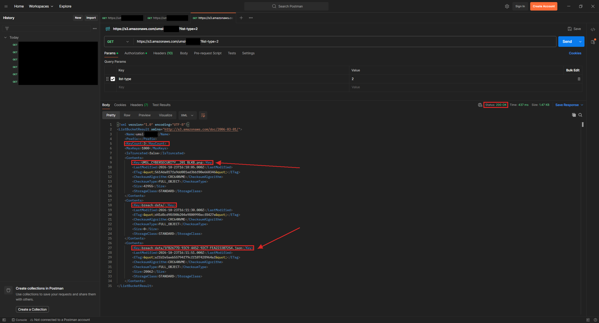
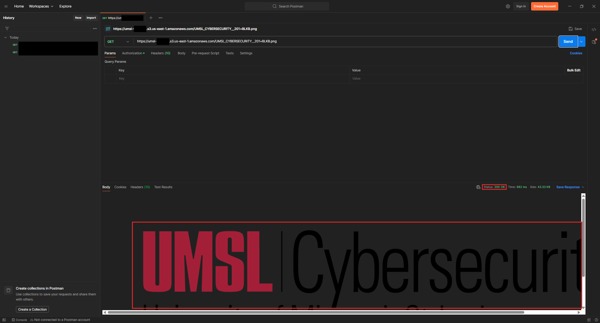
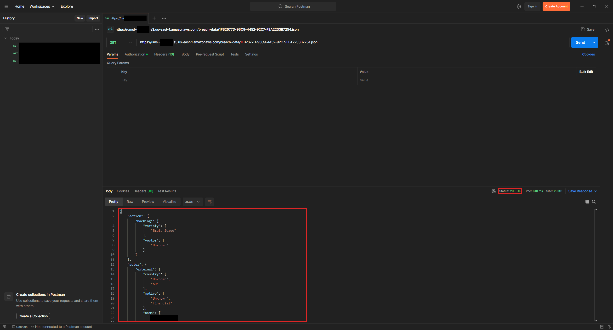

# Lab 8 — Block and Object Storage: Amazon EBS and Amazon S3

## Overview

This lab compared the two main kinds of cloud storage. For **block storage**, I created a 10 GiB **EBS** volume, attached it to one Ubuntu server, and set it up from the command line with `parted`, `mkfs.ext4`, and `/etc/fstab`. Then I moved the volume to a second server, and the file I wrote from the first server was still on it.

For **object storage**, I created an **S3** bucket with all public access blocked, uploaded an image and a JSON file, and read them back with signed HTTP requests from **Postman**, the same way an app would call the S3 API.

## Objectives

- Launch two Ubuntu EC2 instances and set their hostnames
- Create an EBS volume and attach it to `server-1`
- Partition, format, and mount the volume, and keep it mounted after a reboot
- Move the volume from `server-1` to `server-2` without losing data
- Create a private S3 bucket and upload objects to it
- Call the S3 REST API from Postman with AWS Signature authentication

## Tools & Technologies

| Category | Tools |
|---|---|
| Cloud platform | Amazon Web Services (AWS), AWS Academy Learner Lab |
| Services | Amazon EC2, Amazon EBS, Amazon S3, Amazon VPC security groups |
| Linux tools | `hostnamectl`, `lsblk`, `parted`, `mkfs.ext4`, `mount`, `umount`, `/etc/fstab` |
| Other tools | OpenSSH, VPN, Postman |
| Region | US East (N. Virginia) `us-east-1`, AZ `us-east-1a` |

## Block Storage vs Object Storage

| | EBS (block) | S3 (object) |
|---|---|---|
| What it looks like | A raw disk attached to one instance | A bucket of objects, each with a key |
| How I use it | Partition, format, mount, then read and write files | HTTP API calls (PUT, GET, LIST) |
| Folders | Real directories in a file system | No real folders. `breach-data/` is just part of the key. |
| Scope | One Availability Zone | A whole Region, reachable from anywhere with the right credentials |
| Access control | Whoever can log in to the instance | IAM credentials, bucket policies, Block Public Access |

## Architecture

This is the architecture.



---

## Task 1 — Attach, Partition, Format, and Mount an EBS Volume

### 1.1 Launch the two servers

I launched two Ubuntu instances, `server-1` and `server-2`, with these settings:

| Setting | Value |
|---|---|
| AMI | Ubuntu (Quick Start, free tier eligible) |
| Key pair | The same key pair for both, kept in `~/.ssh` |
| Network | Default VPC, subnet in `us-east-1a` |
| Security group | `default`, with an inbound SSH rule for the VPN's address range only |

Because SSH is only open to the VPN's address range, I had to connect to the VPN before I could SSH in. On each server I set the hostname to match its name in the console, then logged out and back in:

```bash
sudo hostnamectl set-hostname server-1     # on the first instance
sudo hostnamectl set-hostname server-2     # on the second instance
```

### 1.2 Create and attach the volume

**EC2 → Elastic Block Store → Volumes → Create volume.**

| Setting | Value |
|---|---|
| Volume type | General Purpose SSD (gp3) |
| Size | 10 GiB |
| Availability Zone | `us-east-1a` (same as both servers) |
| Name | `my_storage_volume` |

Each instance already came with its own 8 GiB root volume, so I named those `server-1-volume` and `server-2-volume`. Then I attached `my_storage_volume` to `server-1` with the device name `/dev/xvdbf`.



### 1.3 Set up the disk on server-1

The new volume showed up in `lsblk` as a blank 10G disk with no partitions.

```bash
lsblk                                                     # find the new 10G disk with no partitions
sudo parted -l                                            # the new disk shows "unrecognised disk label"
sudo parted /dev/nvme1n1 mklabel gpt                      # GPT partition table
sudo parted -a opt /dev/nvme1n1 mkpart primary ext4 0% 100%   # one partition, whole disk
sudo mkfs.ext4 -L my_storage_partition /dev/nvme1n1p1     # ext4 file system with a label
sudo mkdir -p /mnt/my_storage_disk                        # mount point
sudo lsblk --fs                                           # copy the partition's UUID
sudo nano /etc/fstab                                      # add the mount line below
sudo systemctl daemon-reload
sudo mount -a                                             # mount everything in fstab
sudo nano /mnt/my_storage_disk/test-file-1              # "test file created from server-1"
```

The line I added to `/etc/fstab`:

```
UUID=<partition-uuid>  /mnt/my_storage_disk  ext4  defaults  0  2
```

I used the UUID and not the device name because device names can change between boots or between instances, but the UUID belongs to the file system itself. That mattered in Task 2.

In the screenshot below, the boxes show the `server-1` hostname, the 10G partition mounted on `/mnt/my_storage_disk`, the new `fstab` line, and the test file.



---

## Task 2 — Move the Volume to server-2

### 2.1 Unmount and detach from server-1

I had to leave the mount directory before unmounting, or `umount` fails with "target is busy."

```bash
cd ~                                   # get out of the mount directory first
sudo umount /mnt/my_storage_disk
lsblk                                  # partition is still there, but no mount point
```

Then I went to **Volumes → my_storage_volume → Actions → Detach volume**, waited for the state to show **Available**, and attached it to `server-2` as `/dev/xvdbf`. Its state went back to **In-use**.



### 2.2 Mount it on server-2

The volume already had a partition and an ext4 file system, so I **did not** run `parted` or `mkfs` again. That would have wiped `test-file-1`. I only needed a mount point and the same `fstab` line:

```bash
sudo mkdir -p /mnt/my_storage_disk
sudo nano /etc/fstab                   # same UUID line as on server-1
sudo systemctl daemon-reload
sudo mount -a
sudo nano /mnt/my_storage_disk/test-file-2   # "test file created from server-2"
```

The UUID was the same on `server-2` because it's stored on the disk. Both files are on the volume: one written from each server.



---

## Task 3 — Create an S3 Bucket and Upload Objects

### 3.1 Create the bucket

**S3 → Create bucket.** Bucket names have to be unique across all of AWS, so I used `umsl-<ssoid>` with my university ID. I left **Block all public access** turned on, so every request needs valid AWS credentials.



### 3.2 Upload the objects

1. Uploaded the UMSL Cybersecurity logo (`UMSL_CYBERSECURITY__201 BLKB.png`) to the bucket root
2. Created a folder named `breach-data`
3. Uploaded a JSON file with security breach data into `breach-data/`



The console shows `breach-data/` as a folder, but S3 doesn't really have folders. "Creating a folder" just makes an empty object whose key ends in `/`, and the JSON file's key is `breach-data/<file name>.json`. Task 4 shows this.

---

## Task 4 — Call the S3 API from Postman

### 4.1 Set up authentication

Because the bucket is private, every request has to be signed. In Postman I made a new **GET** request and set **Authorization → AWS Signature** with:

| Field | Value |
|---|---|
| Access Key | From **AWS Details → AWS CLI** in the Learner Lab |
| Secret Key | From the same place |
| Session Token | From the same place (the lab uses temporary credentials) |
| AWS Region | `us-east-1` |
| Service Name | `s3` |

Postman uses these to sign each request with Signature Version 4. The keys are temporary and expire when the lab session ends, and I never put them in a screenshot.

### 4.2 List the objects

```
GET https://s3.amazonaws.com/umsl-<ssoid>/?list-type=2
```

`?list-type=2` calls the **ListObjectsV2** API. The response was `200 OK` with XML showing `KeyCount` of **3**: the logo, the `breach-data/` key (0 bytes), and `breach-data/1FB2677D-...json`. The "folder" is just another key.



### 4.3 Get the image

I copied the logo's **Object URL** from the S3 console and sent a GET to it. Postman showed the image in the response body.

```
GET https://umsl-<ssoid>.s3.us-east-1.amazonaws.com/UMSL_CYBERSECURITY__201+BLKB.png
```



### 4.4 Get the JSON

The same thing with the JSON object's URL returned the breach record as JSON.

```
GET https://umsl-<ssoid>.s3.us-east-1.amazonaws.com/breach-data/1FB2677D-93C9-4452-92C7-FEA2233B7254.json
```



---

## What I Learned

- An EBS volume is a blank disk. It needs a partition table, a partition, and a file system before Linux can use it.
- Mounting by UUID in `/etc/fstab` survives reboots and device name changes, and the UUID followed the disk to the second server
- A volume can be unmounted, detached, and attached to another instance in the same AZ, and the data comes with it
- Running `mkfs` on a disk that already has data erases it, so I only formatted the volume once
- S3 is a flat key/value store. "Folders" are just key prefixes with `/` in them.
- With Block Public Access on, every S3 request has to be signed with valid credentials. Apps talk to S3 the same way Postman did, over HTTPS with signed requests.

---

> **Note:** Screenshots are from a temporary AWS Academy lab account. The AWS account ID, my lab session username, the owner ID, the instance, volume, and snapshot IDs, my university ID in the bucket name, and a person's name inside the sample breach data have been redacted. The access keys and session token are never shown. The environment was shut down after I finished.

[← Back to AWS Labs](../)
