# Lab 9 — Build a Database Server with Amazon RDS and Connect a Web App

## Overview

This lab was about **Amazon RDS (Relational Database Service)**, the managed database service where AWS handles the server, patching, and replication for me. I launched a **Multi-AZ MySQL** database inside a private part of the VPC, locked it down so only the web server can reach it, and then pointed an Address Book web app at it.

When I added a contact in the app, it was saved in the RDS database. Because the database is Multi-AZ, AWS also kept a standby copy in a second Availability Zone the whole time.

## Objectives

- Create a security group that only lets the web server talk to the database
- Create a DB subnet group that spans two Availability Zones
- Launch a Multi-AZ Amazon RDS MySQL instance
- Connect a web application to the database and read and write data

## Tools & Technologies

| Category | Tools |
|---|---|
| Cloud platform | Amazon Web Services (AWS) |
| Services | Amazon RDS (MySQL), Amazon VPC, security groups, Amazon EC2 |
| Objects | DB security group, DB subnet group, Multi-AZ DB instance, web server |
| Region | US East (N. Virginia) `us-east-1`, AZs `us-east-1a` and `us-east-1b` |

## What Multi-AZ Means

| | |
|---|---|
| Primary | The database instance the app actually reads from and writes to |
| Standby | A second copy in a different AZ that receives every write synchronously |
| Failover | If the primary or its AZ fails, RDS switches the endpoint to the standby automatically |
| Endpoint | The app connects to one DNS name, so a failover doesn't need an app change |
| Not a read replica | The standby can't serve reads. It's only there for availability. |

## Architecture

This is the architecture.

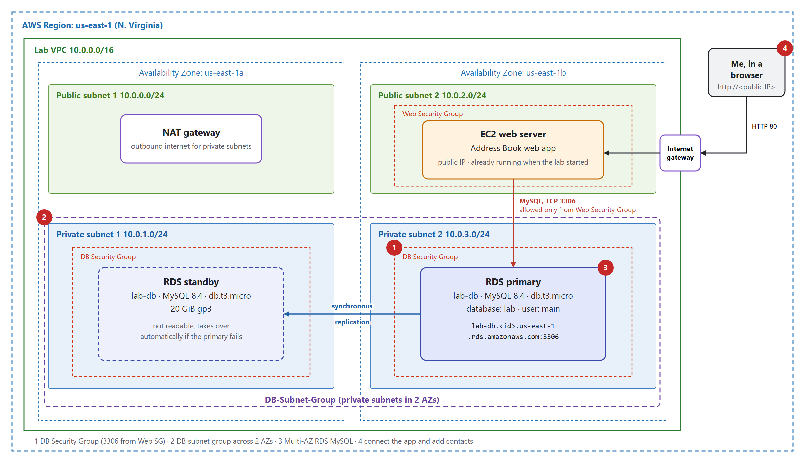

The lab started with the VPC, the four subnets, the NAT gateway, and a web server already running in Public Subnet 2. I added the DB security group, the DB subnet group, and the RDS database in the two private subnets.

---

## Task 1 — Create a Security Group for the Database

**VPC → Security groups → Create security group.**

| Setting | Value |
|---|---|
| Name | `DB Security Group` |
| Description | `Permit access from Web Security Group` |
| VPC | Lab VPC |
| Inbound rule | Type **MySQL/Aurora**, TCP **3306**, Source = the **Web Security Group** |

The source of the rule is another security group, not an IP range. So any instance that has the Web Security Group can reach the database on port 3306, and nothing else can. If the web server's IP changes, the rule still works.

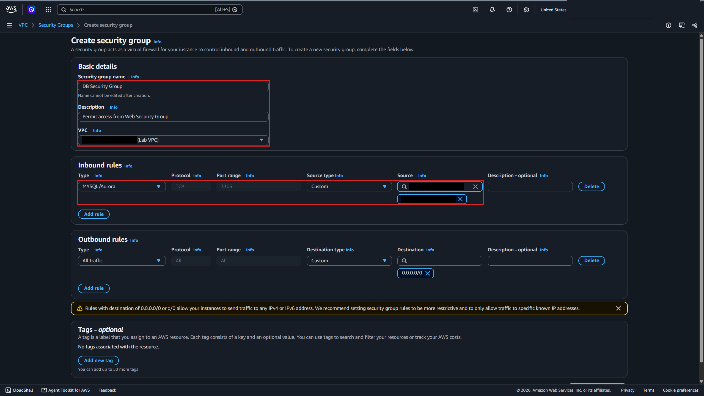

---

## Task 2 — Create a DB Subnet Group

**RDS → Subnet groups → Create DB subnet group.** A DB subnet group tells RDS which subnets it's allowed to put the database in. It needs subnets in at least two Availability Zones, which is what makes Multi-AZ possible.

| Setting | Value |
|---|---|
| Name | `DB-Subnet-Group` |
| VPC | Lab VPC |
| Availability Zones | `us-east-1a`, `us-east-1b` |
| Subnets | Private Subnet 1 `10.0.1.0/24`, Private Subnet 2 `10.0.3.0/24` |

I picked only the **private** subnets, so the database never sits in a subnet that has a route to the internet gateway.

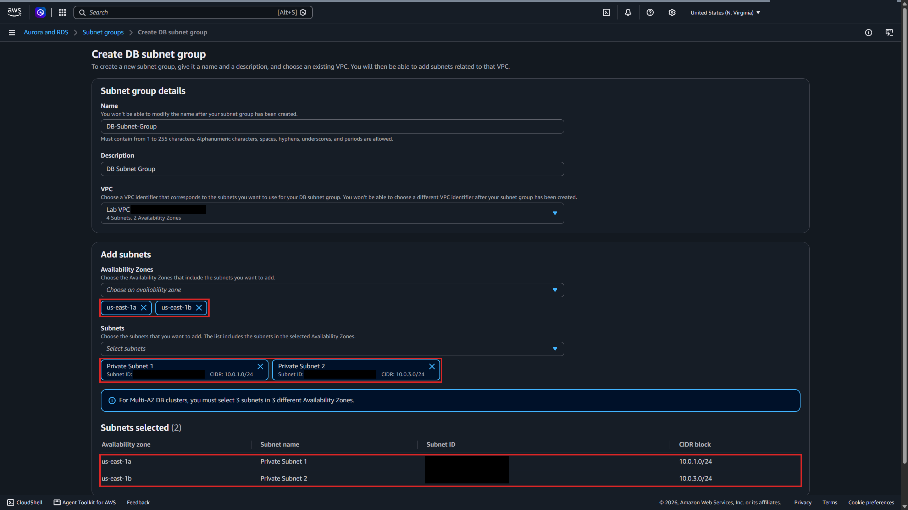

---

## Task 3 — Create the RDS Database

**RDS → Databases → Create database → Full configuration.**

### 3.1 Engine, template, and availability

I chose **MySQL**, the **Dev/Test** template, and **Multi-AZ DB instance deployment (2 instances)**. That option creates a primary and a non-readable standby in a different AZ. The 3-instance "Multi-AZ DB cluster" option also has readable standbys, but this lab only needed failover.

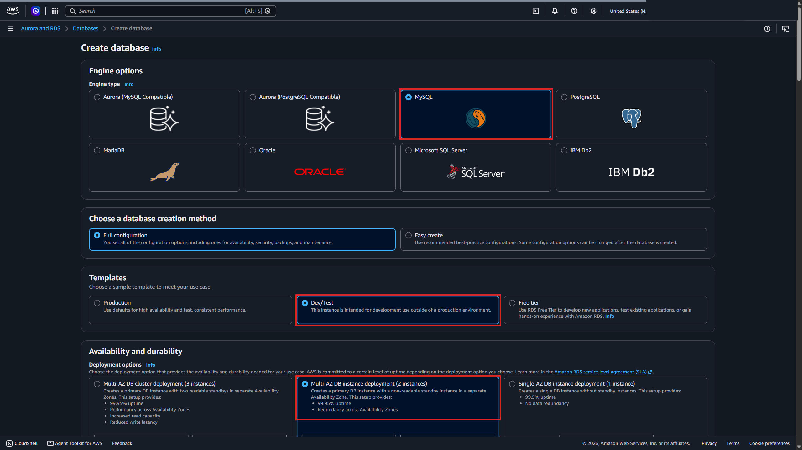

### 3.2 Settings and credentials

| Setting | Value |
|---|---|
| Engine version | MySQL 8.4.11 |
| DB instance identifier | `lab-db` |
| Master username | `main` |
| Credentials management | Self managed, with the password from the lab instructions |

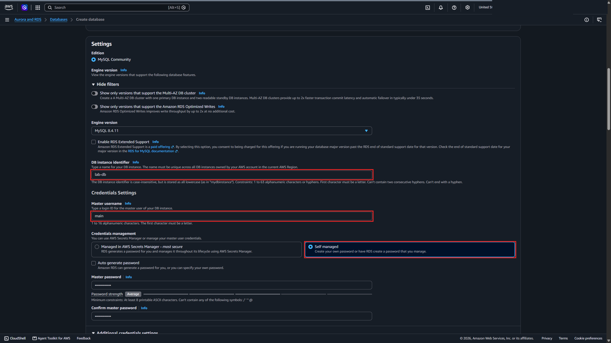

### 3.3 Instance class and storage

| Setting | Value |
|---|---|
| Instance class | Burstable, `db.t3.micro` (2 vCPUs, 1 GiB RAM) |
| Storage type | General Purpose SSD (gp3) |
| Allocated storage | 20 GiB |

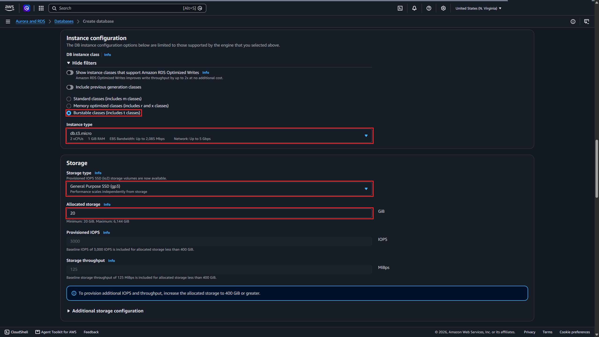

### 3.4 Connectivity

| Setting | Value |
|---|---|
| VPC | Lab VPC |
| DB subnet group | `db-subnet-group` (RDS stores the name in lowercase) |
| Public access | **No** |
| VPC security group | **DB Security Group** only (I removed `default`) |

With public access off, RDS doesn't give the database a public IP, so it can only be reached from inside the VPC. Combined with the security group, that means only the web server can connect.

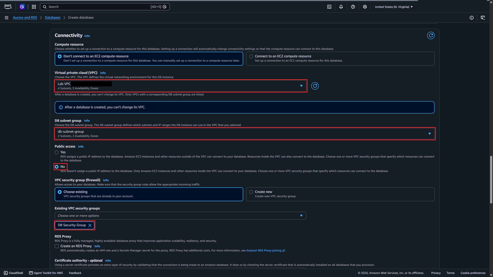

### 3.5 Additional configuration

| Setting | Value |
|---|---|
| Initial database name | `lab` |
| Encryption | Off |
| Automated backups | Off |
| Enhanced monitoring | Off |

I turned off backups and encryption only to make the lab deploy faster. In a real environment I'd leave both on. Enhanced monitoring had to be off because the lab account isn't allowed to create the IAM role it needs.

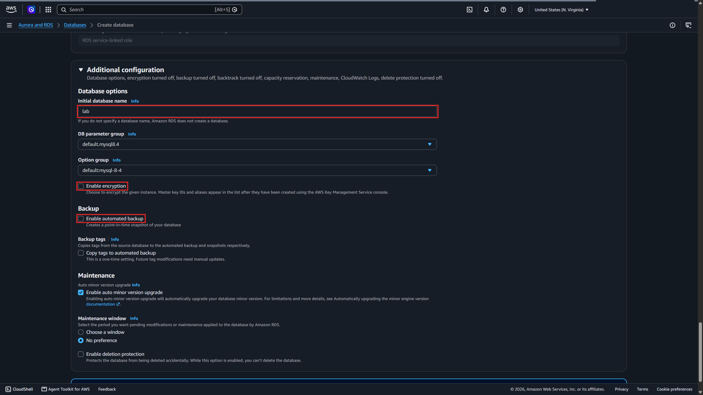

### 3.6 Wait for the database and copy the endpoint

It took a few minutes because RDS was building two instances in two AZs. The summary shows the primary in **us-east-1b**, and the endpoint is the DNS name the app uses to connect. **Publicly accessible** is **No**, and only the DB Security Group is attached.

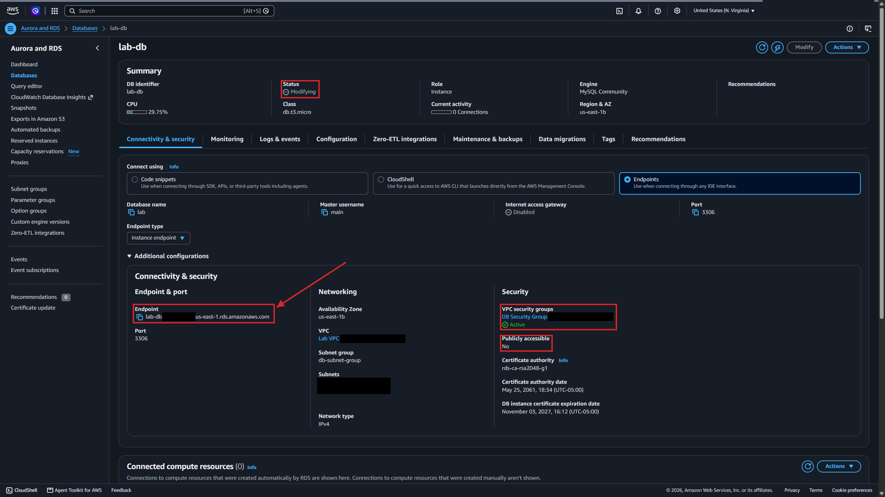

---

## Task 4 — Connect the Web App to the Database

### 4.1 Open the web server

I opened the web server's public IP in a browser. The app showed the instance's metadata, and the server was in `us-east-1b`. Then I clicked **RDS** at the top of the page.

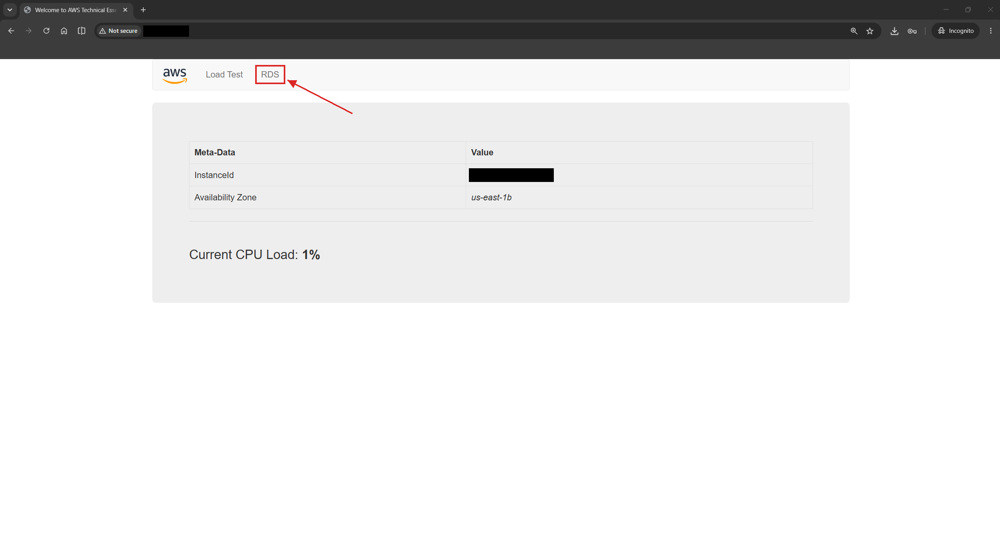

### 4.2 Point the app at RDS

| Field | Value |
|---|---|
| Endpoint | The `lab-db` endpoint from Task 3.6 |
| Database | `lab` |
| Username | `main` |
| Password | The master password |

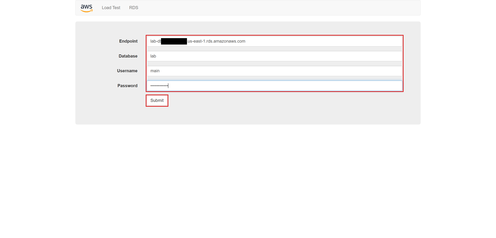

After I submitted, the app copied its starting data into the `lab` database and showed an Address Book with two sample contacts.

### 4.3 Add a contact

I added a new contact with the form.

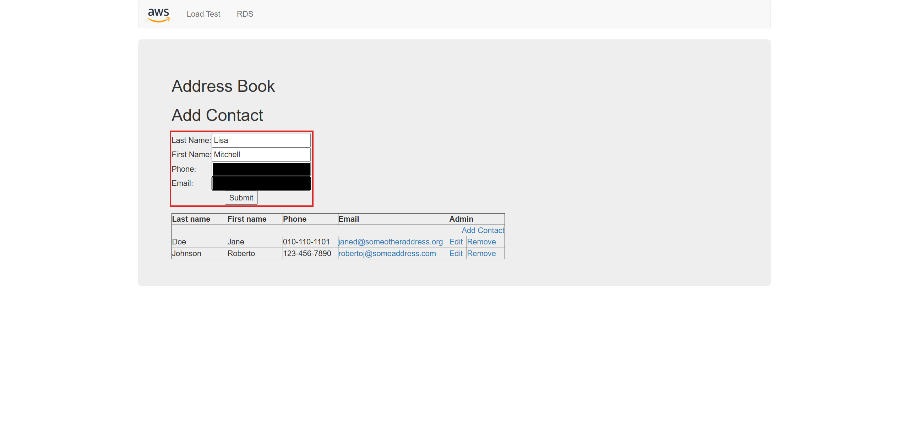

The new row showed up in the table under the two sample contacts. The data lives in RDS, not on the web server, and RDS also copied it to the standby in the other AZ.

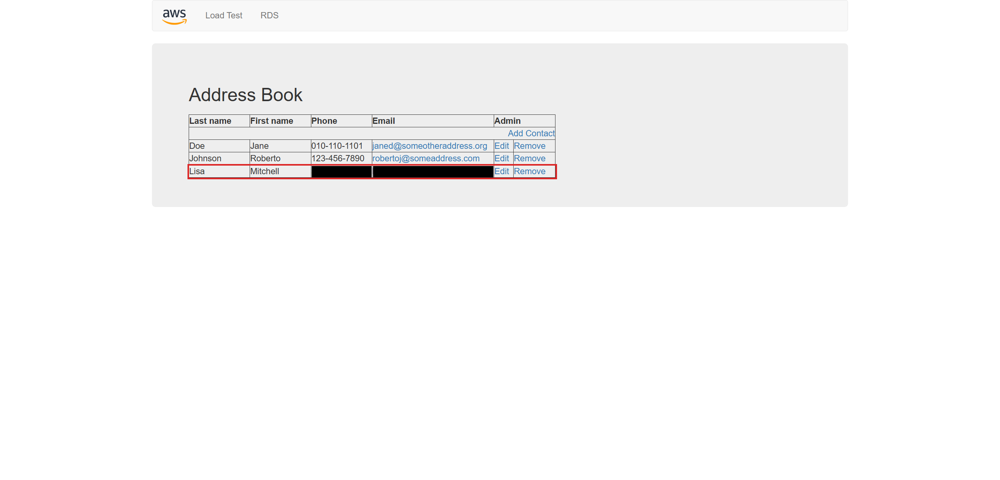

---

## What I Learned

- RDS runs the database server for me, so I only choose the engine, size, and network settings
- A security group rule can use another security group as its source. That's cleaner than IP ranges, because it follows the instances.
- A DB subnet group decides where RDS can place the database, and Multi-AZ needs subnets in at least two AZs
- Putting the database in private subnets with public access off means only resources inside the VPC can reach it
- Multi-AZ keeps a synchronous standby in another AZ for failover, but the standby doesn't serve reads
- The app only needs the endpoint, database name, and credentials. The endpoint stays the same if RDS fails over to the standby.
- Turning off backups and encryption makes a lab faster, but they should stay on for anything real

---

> **Note:** Screenshots are from a temporary AWS lab account. The AWS account ID, my lab session username, the VPC, subnet, security group, and instance IDs, the unique part of the RDS endpoint, the web server's public IP, my browser bookmarks, and the phone number and email of the contact I added have been redacted. The environment was shut down after I finished.

[← Back to AWS Labs](../)
