# Lab 10 — Triggering a GuardDuty Finding: S3 Block Public Access Disabled

## Overview

This lab was a security scenario. A financial services company moved its customer records to Amazon S3 and turned on **Amazon GuardDuty** for threat detection. Then GuardDuty raised this finding:

```
Policy:S3/BucketBlockPublicAccessDisabled
```

My job was to show what causes it. I created an S3 bucket, turned off its **Block Public Access** settings, and also turned them off for the whole account. GuardDuty picked up both changes and created two findings: one for the bucket and one for the account.

## Objectives

- Create an S3 bucket with the default security settings
- Turn off Block Public Access on the bucket
- Turn off Block Public Access for the account
- Find and read the GuardDuty findings those changes caused
- Clean up by deleting the bucket

## Tools & Technologies

| Category | Tools |
|---|---|
| Cloud platform | Amazon Web Services (AWS) |
| Services | Amazon S3, Amazon GuardDuty (S3 Protection), AWS CloudTrail |
| Objects | S3 bucket, bucket and account Block Public Access settings, GuardDuty findings |
| Region | US East (N. Virginia) `us-east-1` |

## How GuardDuty Watches S3

GuardDuty **S3 Protection** keeps an eye on S3 by reading **CloudTrail** events. Every time someone calls an S3 API, like changing a bucket's settings or uploading, downloading, or deleting an object, CloudTrail records who did it and what changed. GuardDuty analyzes those events and creates a **finding** when something looks risky, such as a change that could lead to unauthorized access, data theft, or data deletion. An admin can then investigate and respond before the data is actually compromised.

S3 Protection works on its own once it's enabled. I didn't have to set up any logging or agents for it to catch the changes in this lab.

## Block Public Access: Two Layers

| Layer | Where | What it covers |
|---|---|---|
| Account level | S3 → Account and organization settings | Every bucket in the account, now and in the future |
| Bucket level | Bucket → Permissions | Just that one bucket |

Each layer has the same four settings, and **Block all public access** turns on all four. If either layer blocks something, it's blocked. So a bucket is only really open to the public when both layers are off and there's also a public bucket policy or ACL. Turning off Block Public Access doesn't make data public by itself, but it removes the safety net. That's why GuardDuty flags it.

## Architecture

This is the architecture.

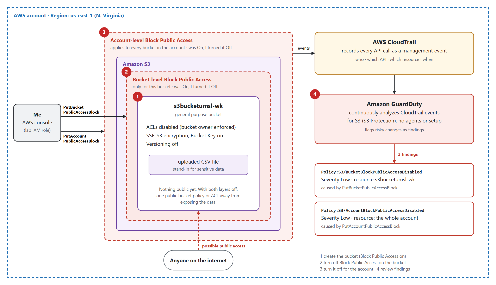

---

## Task 1 — Create the Bucket

### 1.1 Open S3

In the console, I searched for **S3** and opened **General purpose buckets**. The account didn't have any buckets yet.

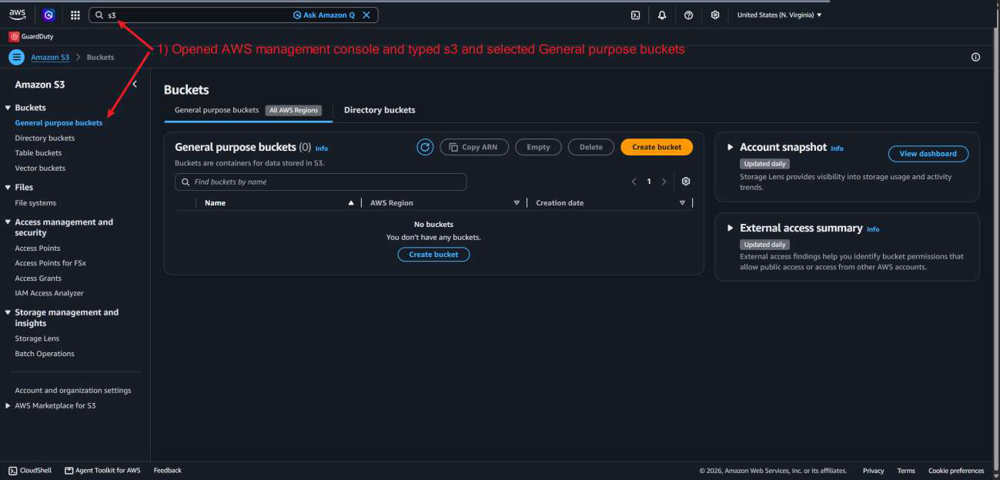

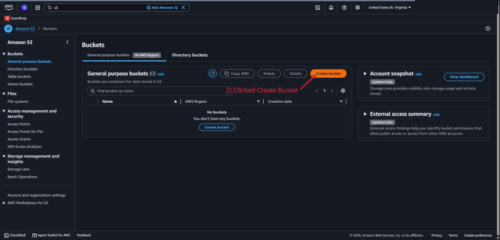

### 1.2 Bucket settings

**Create bucket**, with these settings:

| Setting | Value |
|---|---|
| Bucket type | General purpose |
| Bucket name | `s3bucketumsl-wk` (bucket names have to be unique across all of AWS) |
| Object Ownership | ACLs disabled (bucket owner enforced), the default |
| Block Public Access | **Block all public access** on, the default |
| Bucket Versioning | Disabled, the default |
| Default encryption | SSE-S3, with Bucket Key enabled |

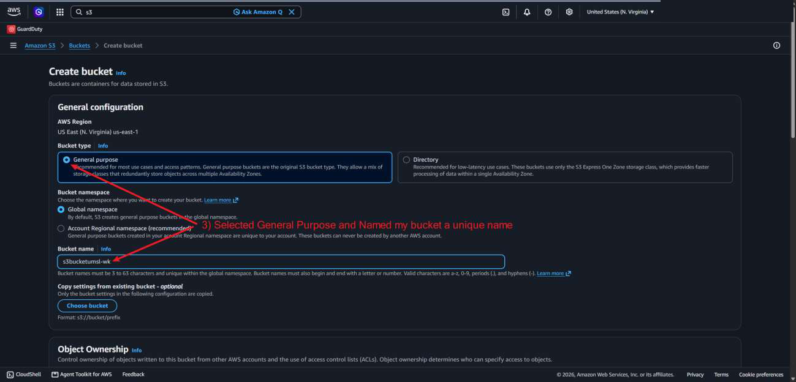

The new bucket started out safe. ACLs were disabled and **Block all public access** was checked.

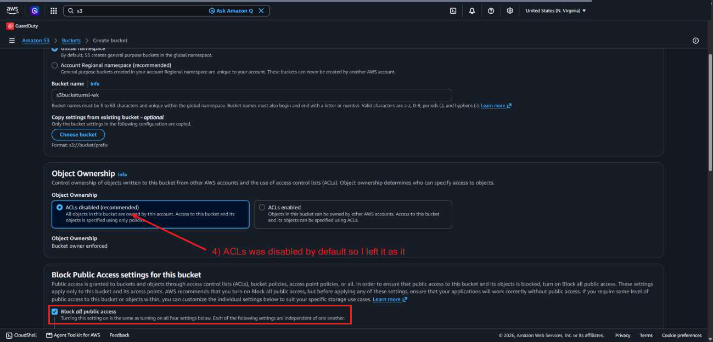

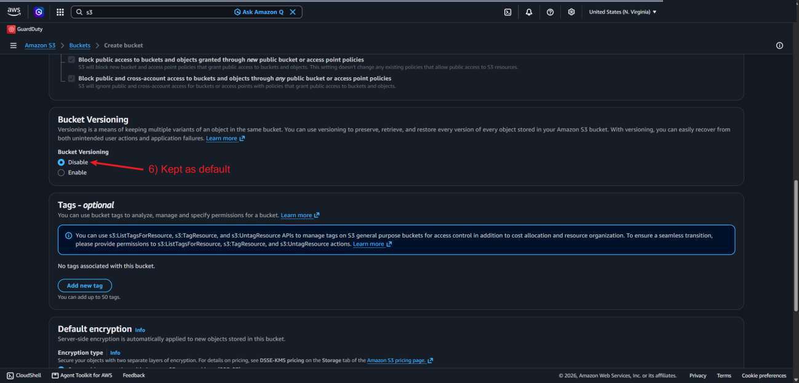

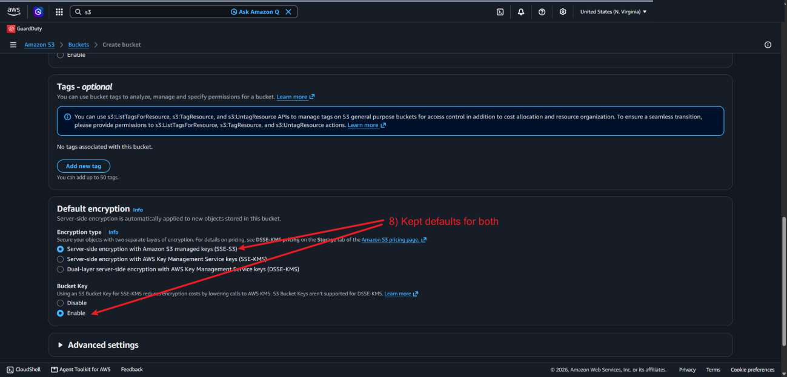

The bucket was created.

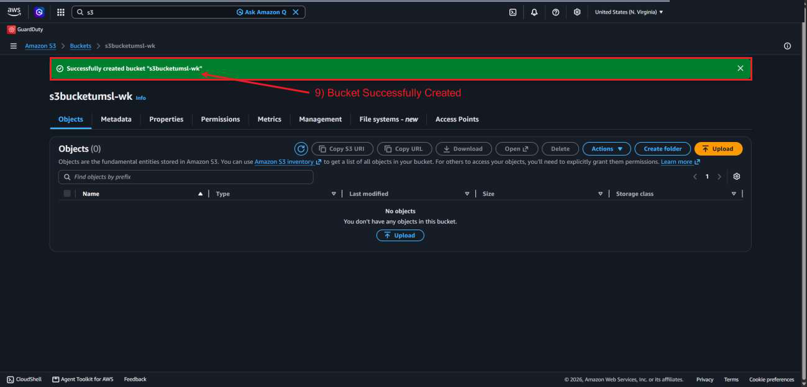

---

## Task 2 — Turn Off Block Public Access on the Bucket

**s3bucketumsl-wk → Permissions → Block public access (bucket settings) → Edit.** I unchecked **Block all public access**, which clears all four settings, and saved.

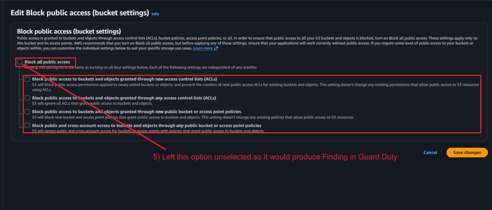

This change is the `PutBucketPublicAccessBlock` API call that leads to the `Policy:S3/BucketBlockPublicAccessDisabled` finding.

---

## Task 3 — Turn Off Block Public Access for the Account

The account-level setting was still on, and it overrides the bucket. To show the full risk, I turned it off too.

**S3 → Account and organization settings.** All four account-level settings were **On**.

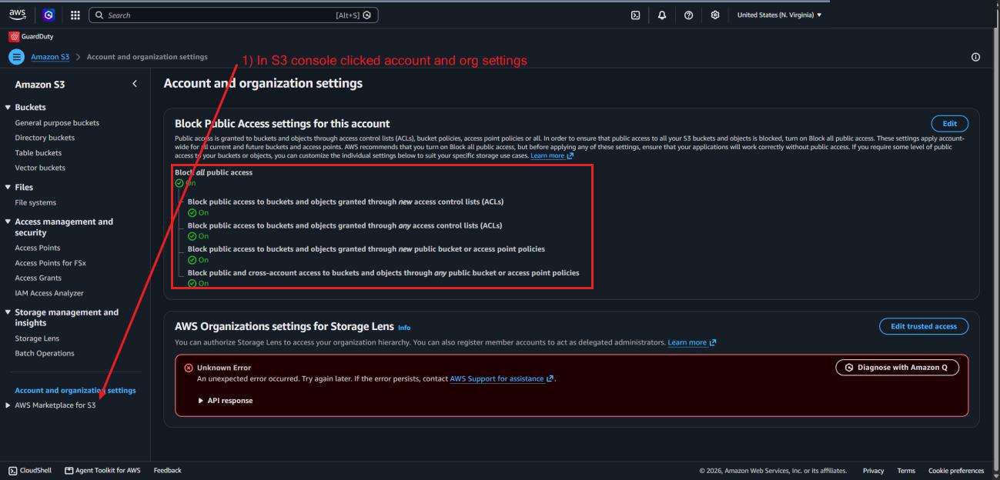

I clicked **Edit**, unchecked **Block all public access**, and clicked **Save changes**.

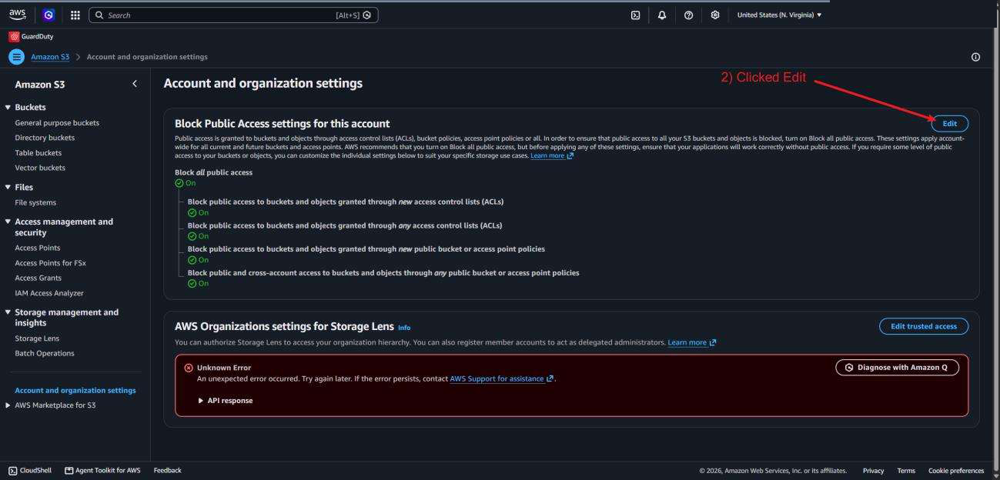

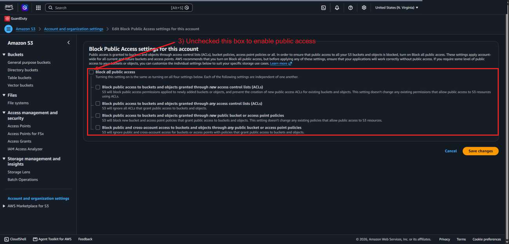

AWS warned that this affects every existing and new bucket in the account, and made me type `confirm`.

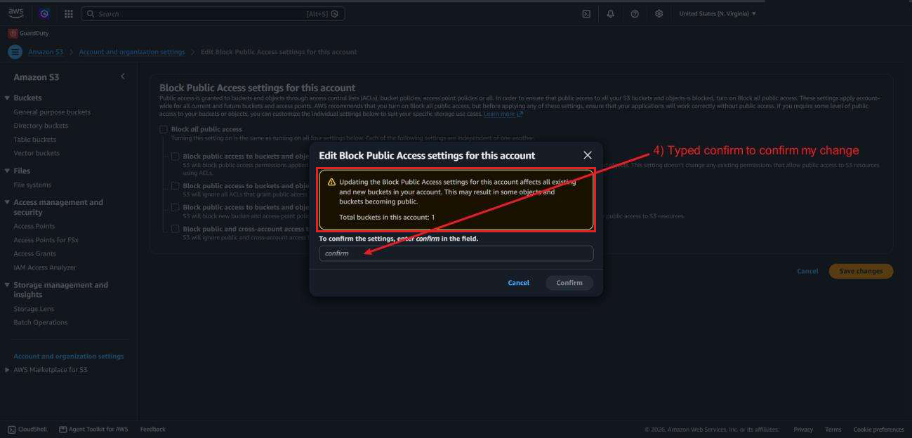

All four account-level settings changed to **Off**.

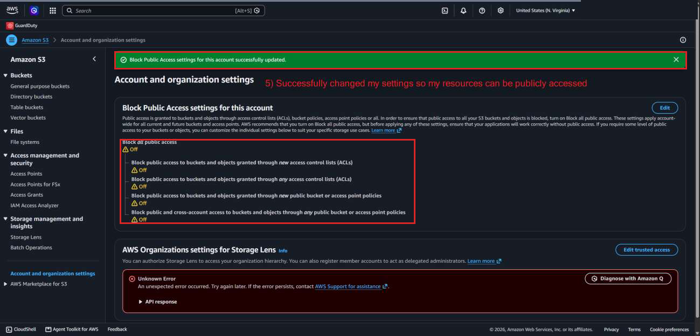

Then I uploaded a CSV file to the bucket as a stand-in for the customer records in the scenario.

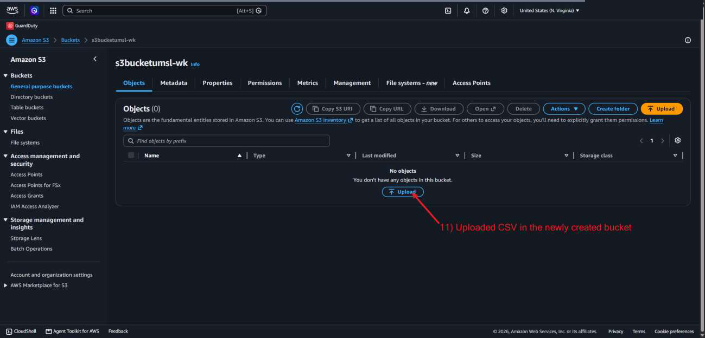

---

## Task 4 — Review the GuardDuty Findings

**GuardDuty → Findings.** There were two new **Low** severity findings, one for each change.

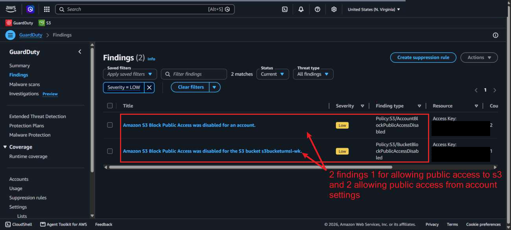

### 4.1 Account finding

| Field | Value |
|---|---|
| Title | Amazon S3 Block Public Access was disabled for an account |
| Type | `Policy:S3/AccountBlockPublicAccessDisabled` |
| Caused by | `PutAccountPublicAccessBlock` |
| Severity | Low |
| Count | 2 (GuardDuty groups repeat events into one finding) |

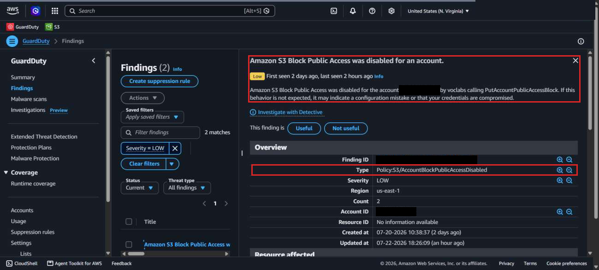

### 4.2 Bucket finding

This is the finding from the scenario.

| Field | Value |
|---|---|
| Title | Amazon S3 Block Public Access was disabled for the S3 bucket s3bucketumsl-wk |
| Type | `Policy:S3/BucketBlockPublicAccessDisabled` |
| Caused by | `PutBucketPublicAccessBlock` |
| Resource | `s3bucketumsl-wk` |
| Severity | Low |

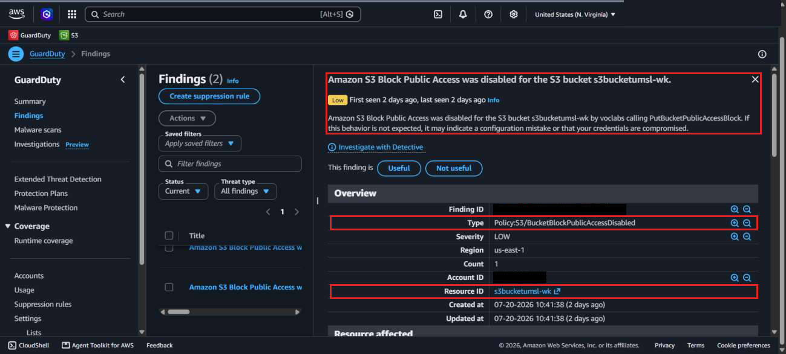

Both findings say the same thing: if this change wasn't expected, it could be a configuration mistake or a sign that someone's credentials were compromised.

### 4.3 What the security team should do

If this showed up in a real account like XYZ Corp's:

1. Check CloudTrail to see who made the change and whether it was approved
2. Turn **Block all public access** back on at the account and bucket level
3. Look for public bucket policies or ACLs on any bucket that holds customer data
4. If the change wasn't approved, treat the credentials that made it as compromised and rotate them

---

## Cleanup

I deleted the bucket so it wouldn't use any more lab credits.

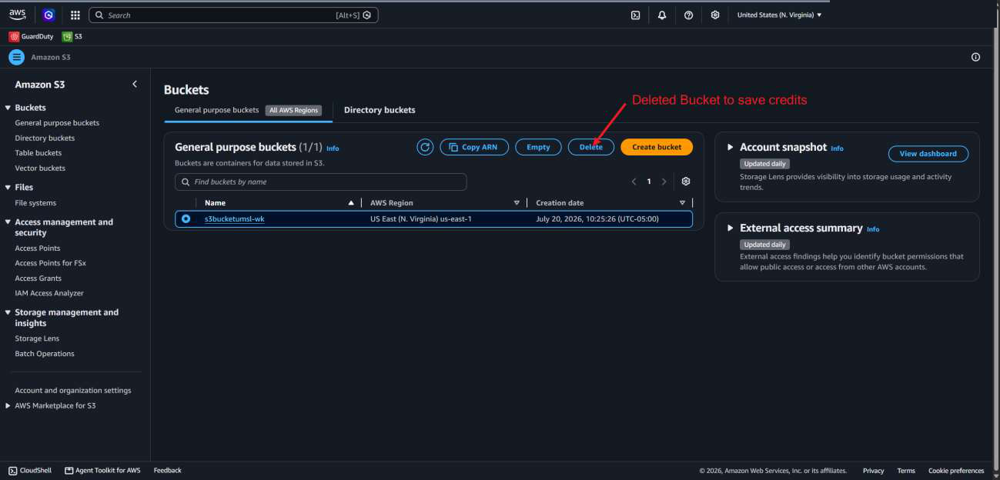

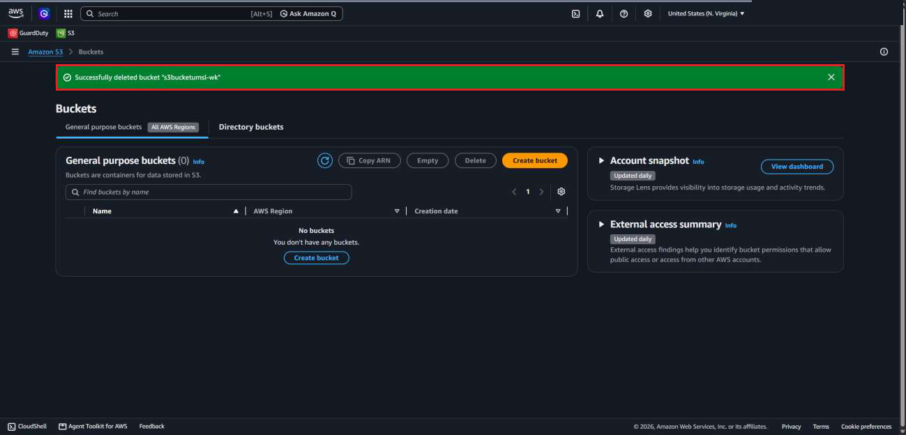

---

## What I Learned

- Block Public Access exists at the account level and the bucket level, and either one can block public access
- Turning off Block Public Access doesn't make data public on its own, but it removes the guardrail. After that, one public bucket policy or ACL is all it takes to leak data.
- GuardDuty S3 Protection finds risky changes by analyzing CloudTrail events, with no extra setup on the bucket
- Each change produced its own finding: `Policy:S3/BucketBlockPublicAccessDisabled` for the bucket and `Policy:S3/AccountBlockPublicAccessDisabled` for the account
- A finding tells me the API call, the resource, and who made the change, which is where an investigation starts
- For buckets with sensitive data, Block Public Access should stay on, and any change to it should be treated as a security event

---

> **Note:** Screenshots are from a temporary AWS lab account. The AWS account ID (including where it appears in the finding text), my lab session username, the GuardDuty finding IDs, and the access key IDs in the findings have been redacted. The bucket was deleted after I finished.

[← Back to AWS Labs](../)
