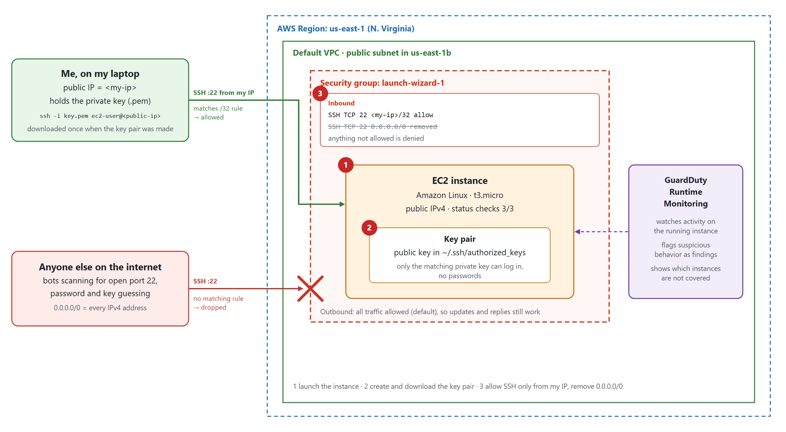
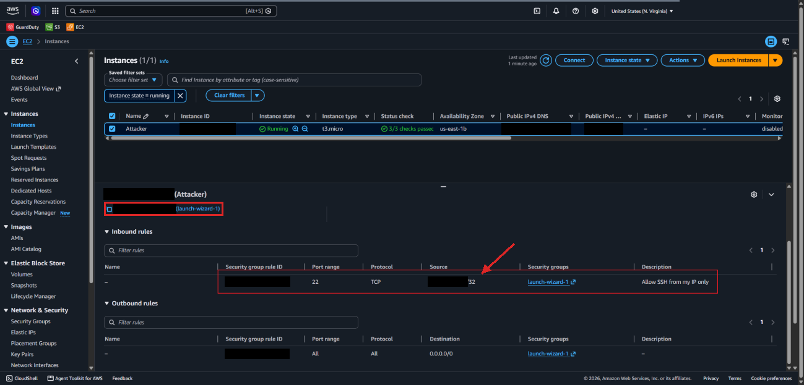

# Lab 11 — Securing SSH Access to an EC2 Instance

## Overview

In this scenario I was a junior cloud engineer at a startup getting ready to host a web app on AWS. The company was worried about people getting into its servers without permission, so my manager asked me to launch an EC2 instance and lock down SSH access.

I launched the instance with a **key pair** for login and set its **security group** so SSH (port 22) only accepts connections from **my own IP address**. There's no `0.0.0.0/0` rule for SSH, so the rest of the internet can't even reach the login prompt.

## Objectives

- Launch a small EC2 instance
- Create and download a key pair for SSH
- Allow SSH only from my IP address
- Make sure there's no "allow all" (`0.0.0.0/0`) rule for SSH

## Tools & Technologies

| Category | Tools |
|---|---|
| Cloud platform | Amazon Web Services (AWS) |
| Services | Amazon EC2, security groups, key pairs, Amazon GuardDuty |
| Protocol | SSH (TCP 22) |
| Region | US East (N. Virginia) `us-east-1`, AZ `us-east-1b` |

## Two Layers of SSH Protection

| Layer | What it does | What it stops |
|---|---|---|
| Security group | Only lets TCP 22 in from `<my-ip>/32` | Everyone else's traffic is dropped before it reaches the instance |
| Key pair | The instance only accepts the matching private key | Password guessing, since there's no password to guess |

`/32` means exactly one IP address. `0.0.0.0/0` means every IPv4 address, which is what bots scan for when they look for open SSH ports.

## Architecture

This is the architecture.



---

## Task 1 — Launch the Instance

**EC2 → Launch instance.** I launched one small Linux instance in the default VPC. The screenshot below shows it **Running** as a `t3.micro` in `us-east-1b`, with **3/3 status checks passed** and a public IPv4 address. Its name tag is **Attacker**.

## Task 2 — Create a Key Pair

While launching, I created a new key pair and downloaded the private key (`.pem`). AWS keeps the public key and puts it on the instance. The private key only downloads once, so I saved it right away. To connect, I'd run:

```bash
chmod 400 key.pem
ssh -i key.pem ec2-user@<public-ip>
```

`chmod 400` makes the key readable only by me. SSH refuses to use a private key that other users can read.

## Task 3 — Restrict SSH in the Security Group

The launch wizard created a security group named `launch-wizard-1`. I set its inbound rules to this:

| Type | Protocol | Port | Source | Description |
|---|---|---|---|---|
| SSH | TCP | 22 | `<my-ip>/32` | Allow SSH from my IP only |

There's no `0.0.0.0/0` rule for SSH. Security groups deny anything that isn't explicitly allowed, so with only this rule, SSH from any other address never reaches the instance. Outbound stayed at the default (all traffic), so the instance can still download updates and send replies.

In the screenshot, the box shows the security group attached to the instance, and the arrow points at the inbound rule's source: one IP address (`/32`).



---

## Why Restricting SSH Matters

Restricting SSH limits who can connect to the instance remotely. Allowing only my IP address keeps unauthorized users out and shrinks the attack surface, because bots scanning the internet for open port 22 can't reach the server at all. SSH encryption then keeps passwords, commands, and other data private while I'm connected.

## Related: GuardDuty EC2 Runtime Monitoring

A security group controls who can connect, but it doesn't watch what happens on the instance. That's where **GuardDuty Runtime Monitoring** comes in. Once it's turned on, GuardDuty watches activity on running EC2 instances and creates findings for anything unusual, like suspicious processes or signs that someone is trying to get in without permission. It also shows which instances are covered, so an admin can spot any that are left unprotected.

From what I learned in AZ-900 and SC-300, it reminded me of **Microsoft Defender for Cloud**, since both continuously monitor cloud resources and flag threats early. Comparing the two made it easier to understand how AWS approaches security monitoring.

---

## What I Learned

- Security groups are allow-lists. Anything not allowed is denied, so the safest SSH rule is one that names a single IP.
- `/32` is one address and `0.0.0.0/0` is the whole internet, so SSH should never be open to `0.0.0.0/0`
- A key pair replaces passwords. Only someone with the private key can log in, and the private key only downloads once.
- If my home IP changes, I have to update the rule, which is a small price for keeping port 22 closed to everyone else
- Network rules and runtime monitoring work together: the security group keeps people out, and GuardDuty watches for anything that gets through

---

> **Note:** The screenshot is from a temporary AWS lab account. The AWS account ID, my lab session username, the instance ID, the security group and rule IDs, the instance's public IP and DNS name, and my home IP address in the SSH rule have been redacted. The environment was shut down after I finished.

[← Back to AWS Labs](../)
